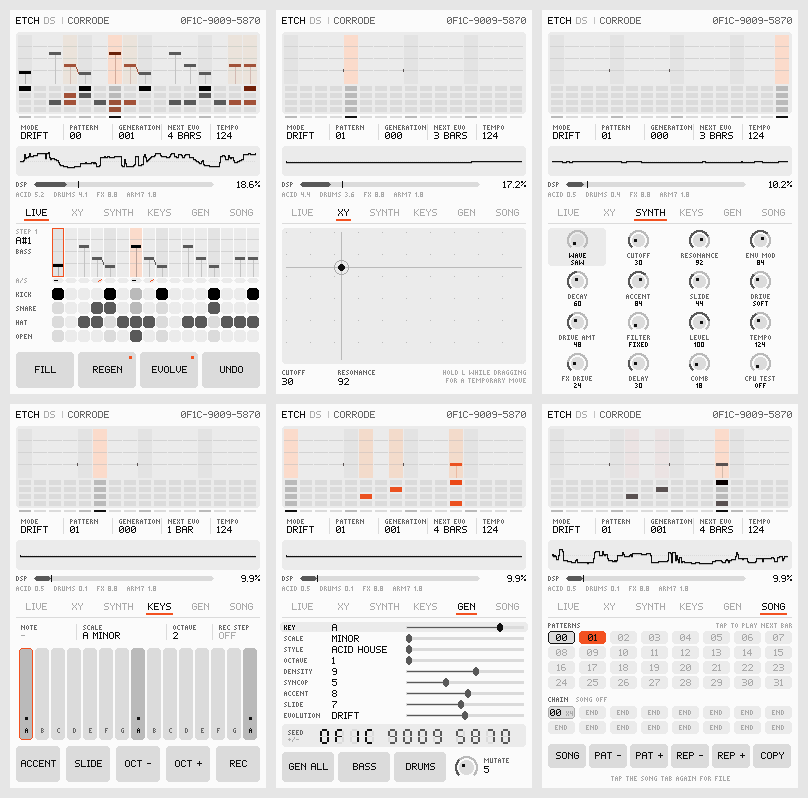
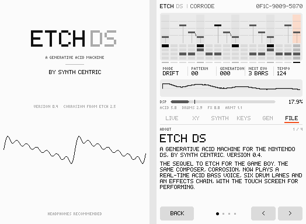

# ETCH DS

**A generative acid machine for the Nintendo DS — by Synth Centric**

ETCH DS is the Nintendo DS sequel to [ETCH](https://github.com/swebdan-design/Etch---GB), the Game Boy generative acid machine. It keeps ETCH's composer, CORROSION (byte for byte, so every ETCH seed code makes the same groove), synthesises the 303 sound for real, and adds the touch screen.

This is **milestone 1, "It squelches"**. It proves the sound before any interface is built:

* **Press START, hear music.** It boots into ETCH's demo song CORRODE, composed by CORROSION from its seed code `0F1C-9009-5870` and living in DRIFT: every 4 bars, every channel changes a little.
* **ACID**, the 303 voice: SAW, SQUARE, HOLLOW and BITE (band-limited), a real-time resonant 4-pole ladder (303 mode or ETCH's key tracking), a filter envelope, an accent that charges on repeated accents, constant-time slide and drive (OFF / SOFT / HARD / FOLD).
* **FOUNDRY**: six drum lanes synthesised into samples, with ETCH's kits as presets.
* **FX chain**: drive → crush → tempo-synced degrading delay → metallic comb → limiter.
* **Sequencer** on the ARM7: ETCH's step rules and ETCH II's fixed swing clock, sample-accurate on a 32-sample grid.
* **XY pad** on the bottom screen: X = cutoff, Y = resonance.



The milestone report is [`docs/MILESTONE1_REPORT.md`](docs/MILESTONE1_REPORT.md), the design is in [`docs/ARCHITECTURE.md`](docs/ARCHITECTURE.md), and parked ideas are in [`docs/IDEAS.md`](docs/IDEAS.md).

## The screens



**Title.** As on ETCH and ETCH II, it opens on the name, "by Synth Centric", and PRESS START. START (or a tap) goes straight into the music, and the moment you press it seeds the living song.

**ABOUT.** FILE → ABOUT has four pages: ETCH DS, generative music, Synth Centric (the bio) and credits and licences. Use LEFT/RIGHT or the arrows to turn the pages, and B or BACK to return.

**Top (always):** the machine's face plate. It shows the song, the seed code and an amber 7-segment tempo. The pattern sits in a recessed display: the bass line as pitch, plus ETCH's four drum lanes. Steps that CORROSION has just changed glow acid green and fade. Below the pattern are a row of step LEDs, the mode, the generation and the bars until the next evolution, an oscilloscope, and the per-stage CPU meter.

**Bottom tabs:**

| Tab | What it does |
|---|---|
| LIVE | The pattern, editable. Bass: tap an empty step to place the last note, tap a note to rest it, and drag up or down anywhere in a step to move it by scale steps (one per 6 px). The note's name is shown beside the lane. Tap the A/S strip under a step to cycle accent and slide. Tap or swipe drum cells. Tap a row name to mute it. The pads are FILL, REGEN, EVOLVE and UNDO. |
| XY | X sets cutoff and Y sets resonance, with a fading trail and 7-segment readouts. |
| SYNTH / DRUM | Tap SYNTH again for DRUM. **SYNTH:** knobs for ACID (wave, cutoff, resonance, env mod, decay, accent, slide, drive, drive amount, filter mode, level), BPM, FX drive, delay, comb, and CPU TEST. Patch cables come later. **DRUM:** FOUNDRY's drum synth. Pick a lane (tapping it plays it) and shape the sound in the kit slot the playing pattern uses: KIT, MODEL (kick, snare, clap, rim, hat, metal, blip, ring, crush), PITCH, PITCH END, SWEEP, DECAY, NOISE, DRIVE, TUNE and LEVEL, with a waveform view. Each edit re-synthesises the drum while the song plays. Knobs a model doesn't use are dimmed, and RESET restores ETCH's preset. |
| KEYS | Two octaves of the GEN key and scale only, so there are no wrong notes. ACCENT and SLIDE latches (with SLIDE on, dragging between keys glides). OCT −/+. REC: while playing, a key writes into the step that is sounding; while stopped, it writes step by step, and B + A writes a rest. A held key takes the 303 from the sequencer. |
| GEN | CORROSION's settings on faders, the seed code on a 7-segment pad (tap above or below a digit), GEN ALL / GEN BASS / DRUMS, and the mutation dial. |
| SONG / FILE | Tap the SONG tab again for FILE. **SONG:** the 32 patterns: tap one to play it from the next bar, or with SONG on, to put it in the selected chain slot. ETCH's 16-slot chain with repeats: tap a slot to select it, tap it again to jump there. SONG on/off, PAT −/+, REP −/+, and COPY (the playing pattern into the next empty one). **FILE:** 16 save slots on the SD card, plus ABOUT; LOAD, ERASE and overwrites ask twice. Loading jumps to LIVE and plays. The GB button lists ETCH Game Boy saves to import (read only); press it again (GBA) for ETCH II saves. |

## Controls

The controls and the look follow the ETCH series spec ([`docs/SERIES_SPEC.md`](docs/SERIES_SPEC.md)), shared by ETCH, ETCH II, ETCH DS and ETCH 3DS. The accent colour **#F45423** marks whatever is happening now: the playhead, the cursor, the current tab, lit pads and the steps CORROSION has just changed.

| | |
|---|---|
| START | play / stop (the moment you press it seeds the living song) |
| SELECT + LEFT / RIGHT | previous / next tab (or tap the tab bar) |
| D-pad | move the cursor on the current tab |
| A | place or toggle (on LIVE: a note, a hit, a mute, a pad) |
| A + D-pad | change the value under the cursor (LIVE bass: LEFT/RIGHT a semitone, UP/DOWN an octave, as on every ETCH) |
| X / Y | on a LIVE bass note: accent / slide on or off |
| B + A | delete |
| SELECT + A | evolve at the next bar |
| SELECT + B | undo the last generation |
| SELECT + UP / DOWN | queue the next / previous pattern (song mode turns off) |
| SELECT + START | latched fill on / off (a fresh variation every bar) |
| B (tap, on LIVE) | latched fill on / off |
| hold R | fill while held: a fresh variation every bar until you let go |
| hold L while dragging | temporary move: it springs back when you let go |
| knob drags | up or right turns a knob up; the whole range takes about 90 px |

Touch is single-point everywhere, and it is never needed for sound.

## Saves

Projects live in `/etch_ds/etch_ds.sav` on the SD card. The file holds 16 fixed slots of 16 KB, mirroring ETCH's SRAM layout. Each slot is ETCH's `project_t`, byte for byte, plus the DS sound settings and your drum designs (save version 2; version-1 saves still load), under a header with ETCH's Fletcher-16. Saves use ETCH's write order:

1. invalidate the slot
2. write the data
3. checksum what is actually on the card
4. write the header, with the magic last
5. read everything back

A damaged or half-written slot is reported and never loaded. To import ETCH Game Boy projects, copy the cartridge's 32 KB `.sav` to `/etch_ds/etch_gb.sav`. To import ETCH II (Game Boy Advance) projects, copy its 32 KB `.sav` to `/etch_ds/etch_gba.sav`: the song name, generator, all 32 patterns, tempo, chain and drum voicing come across exactly (checked with CRC-32). ETCH II's synth patches and extension tracks have no place on the DS, so your current DS sound is kept. Saving needs a flash cart or loader that DLDI-patches homebrew, which most do automatically.

## Release (version 0.4)

The `release/` folder is the delivery:

| File | What it is |
|---|---|
| `etch_ds.nds` | the ROM |
| `ETCH_DS_Manual.pdf` (and `.md`) | the user manual |
| `ETCH_DS_source.zip` | the source at this release |
| `SHA256SUMS.txt` | checksums of the files above |

`tools/check_series_controls.py` runs the ROM in melonDS, checks the series controls (7 checks) and screenshots every tab.

## Building

Requirements: [BlocksDS](https://blocksds.skylyrac.net/) (tested with 1.25.0 / Wonderful GCC 16.2). The simplest route is BlocksDS's Docker image:

```bash
docker run --rm -v "$PWD":/work -w /work skylyrac/blocksds:slim-latest make
```

With BlocksDS installed natively (in `/opt/blocksds/core`, or `/opt/wonderful/thirdparty/blocksds/core`, or `BLOCKSDS=...`):

```bash
make
```

This writes `etch_ds.nds`. Before compiling, `make` checks that `corrosion/` still matches ETCH 2.5 byte for byte (`corrosion/SHA256SUMS`).

## Testing

The host tests need a host C compiler. The audio-path check and melonDS runs need Python 3 with NumPy, plus Pillow for screenshots.

```bash
make test
```

```bash
python3 tools/check_audio_path.py
```

```bash
tools/melonds_harness/build.sh /path/to/melonDS
```

```bash
python3 tools/run_melonds.py --frames 3600 --stress --touch
```

* `make test` first checks the CORROSION checksums, then runs:
  * ETCH's 44 CORROSION tests (`tests/host/test_generator.c`, copied unmodified) against `corrosion/`
  * 216 sequencer checks: tempo, swing, the swing-change fix, step rules, dice and conditions, the commit point, the edit epoch, stop and stress
  * 81 sound-engine checks: stability over every setting, the resonant peak, constant-time slide, accent charging, 303 versus KEY tracking, and a full render of the boot song through the real sequencer
  
  It writes listenable WAVs to `build/host/`.
* `tools/check_audio_path.py` proves that no division, modulo or floating-point routine is reachable from the render interrupt.
* `tools/melonds_harness/build.sh` builds the headless melonDS harness against a melonDS checkout (core library built with CMake and `-DBUILD_QT_SDL=OFF`).
* `tools/run_melonds.py` runs the ROM in that harness. It presses START, optionally drags the XY pad and runs the CPU test, reads the per-stage CPU meter, the dropout counter and the sequencer counters from emulated RAM, records `build/melonds/*.wav`, takes screenshots and analyses the audio.

To regenerate the DSP tables (Python 3 + NumPy):

```bash
make tables
```

## Layout

```
common/        ipc.h (ARM9<->ARM7 contract), seq_core.c (the sequencer)
arm7/source/   the ARM7 core: clock, streaming, commands, input
arm9/source/   boot + render IRQ, CORROSION scheduling, screens, sound engine
corrosion/     CORROSION from ETCH 2.5, byte-identical (checksummed)
tests/host/    host tests
tools/         table generator, audio-path checker, melonDS harness + runner
docs/          architecture, milestone report, ideas
```

## Credits

**ETCH DS — by Synth Centric.** Synth Centric is Dan Schwebel. CORROSION and ETCH's oscillator recipes come from ETCH (MIT; see `corrosion/LICENSE.ETCH`); the swing-change fix and the edit epoch come from ETCH II. Built with BlocksDS; tested with melonDS. Licences and trademarks: see [`THIRD_PARTY_NOTICES.md`](THIRD_PARTY_NOTICES.md). TB-303 is a trademark of Roland Corporation; ETCH DS is not affiliated with Roland or Nintendo.
