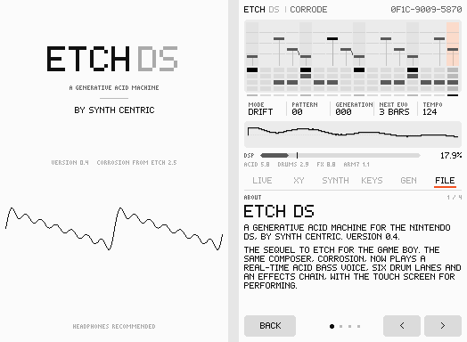
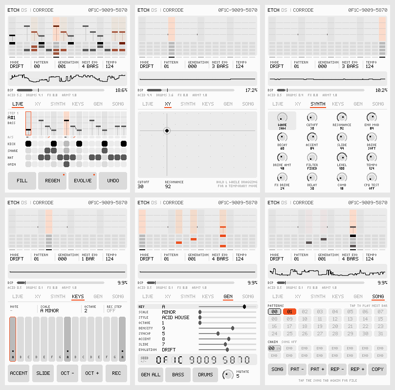
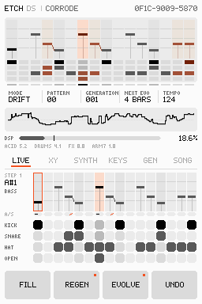
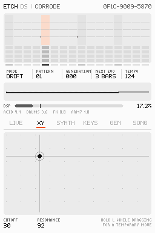
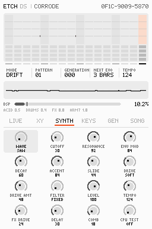
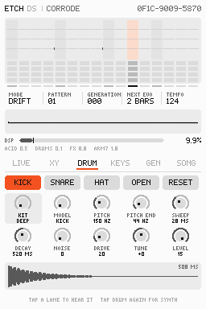
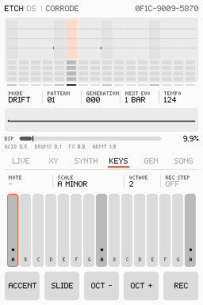
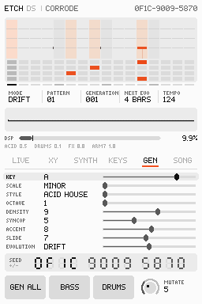
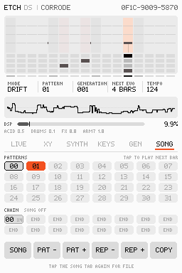
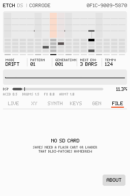

# ETCH DS — A Generative Acid Machine

**by Synth Centric**

**User Manual — version 0.4**

## 1. What ETCH DS is

ETCH DS turns a Nintendo DS into an acid machine that writes its own music. It has:

- **ACID**, a real-time 303-style bass voice: four waveforms, a resonant filter, accent, slide and drive.
- **FOUNDRY**, six drum lanes synthesised on the console, with ETCH's kits as presets and a drum designer.
- **An effects chain**: drive, bit-crush, a tempo-synced delay that degrades as it repeats, a metallic comb filter and a limiter.
- **CORROSION**, the composer from ETCH for the Game Boy, byte for byte. It writes a bass line and drums from a seed, and keeps rewriting them while they play.
- **The touch screen** for performing: an XY pad, a two-octave keyboard, knobs and pads.

ETCH DS is part of a series: **ETCH** (Game Boy), **ETCH II** (Game Boy Advance), **ETCH DS** and **ETCH 3DS**. They share one composer, one set of controls and one look. A 12-digit seed code makes the same groove on all of them, and ETCH DS can import songs saved on ETCH and ETCH II.

## 2. Quick start

1. Copy `etch_ds.nds` to your flash cart (or open it in an emulator such as melonDS).
2. Start it. On the title screen, press **START** (or tap the screen).
3. Music starts at once: the demo song CORRODE, living in DRIFT, so it changes a little every 4 bars.
4. On the bottom screen, tap **XY** and drag your finger: left/right is the filter cutoff, up/down the resonance.
5. Tap **LIVE** and tap **FILL**, then **REGEN**: a drum fill, then half the bar rewritten.
6. Headphones are recommended: the DS speakers can't play bass.

## 3. The two screens

**Top screen (always):** the machine's face. It shows the song name and seed code, the pattern (the bass line as pitch, plus four drum lanes), a row of step lights, the readouts MODE · PATTERN · GENERATION · NEXT EVO · TEMPO, an oscilloscope and the CPU meter.

**Bottom screen:** six tabs, **LIVE · XY · SYNTH · KEYS · GEN · SONG**. Tap a tab, or press **SELECT + ←/→**. Tapping SYNTH again opens its second page, DRUM; tapping SONG again opens FILE.

**The look.** Black on white, grey captions over black values, and one accent colour, orange **#F45423**, for whatever is happening now: the playhead, the cursor, the current tab, a lit pad, and the steps CORROSION has just changed (they glow and fade over the next bars).

## 4. Controls

Touch is never needed for sound: everything can be done with the buttons.

### Everywhere

| Buttons | What it does |
|---|---|
| START | Play / stop. The moment you press it seeds the living song. |
| SELECT + ←/→ | Previous / next tab |
| SELECT + ↑/↓ | Queue the next / previous pattern (it switches at the bar line; song mode turns off) |
| SELECT + A | Evolve now (at the next bar) |
| SELECT + B | Undo the last evolution or generation |
| SELECT + START | Fill on / off (latched: a fresh fill every bar until you switch it off) |
| hold R | Fill while held |
| hold L while dragging | A temporary move: it springs back when you let go |

### Editing (the same on every ETCH)

| Buttons | What it does |
|---|---|
| D-pad | Move the cursor |
| A | Place or toggle (a note, a hit, a mute, a pad) |
| A + ←/→ | Value down / up. On a bass note: a semitone. |
| A + ↑/↓ | Value up / down in big steps. On a bass note: an octave. |
| B + A | Delete |
| B (tap, on LIVE) | Fill on / off |
| X / Y (on a LIVE bass note) | Accent / slide on or off |

## 5. LIVE — the pattern, and performing

The pattern you hear, editable:

- **BASS** shows each note as a bar at its pitch. Tap an empty step to place the last note you used; tap a note to make it a rest; drag up or down on a step to move it by scale steps. The note's name shows beside the lane.
- **A/S** under each step: tap it to cycle accent and slide (or use X and Y on the buttons).
- **KICK · SNARE · HAT · OPEN**: tap or swipe cells to set hits. Tap a lane's name to mute it.
- **The pads:** **FILL** (a drum fill), **REGEN** (exactly half the bar is replaced with new material in the song's key and style), **EVOLVE** (CORROSION mutates the pattern at the next bar) and **UNDO**. The small dot on REGEN and EVOLVE means they rewrite music.

With the buttons: move with the D-pad (left of step 1 is the lane name), A places or toggles, A + ←/→ and A + ↑/↓ move a bass note by a semitone or an octave, X and Y set accent and slide, B + A deletes.

## 6. XY — the filter by hand

Drag anywhere: left/right sets the cutoff, up/down the resonance. A fading trail shows where you've been, and the values show at the bottom. Hold **L** while you drag for a temporary move that springs back when you let go.

## 7. SYNTH and DRUM — the sound

**SYNTH** is a panel of knobs. Drag a knob up or right to turn it up (the whole range is about 90 px of travel), or select it with the D-pad and use A + ←/→.

- **ACID:** wave (SAW, SQUARE, HOLLOW, BITE), cutoff, resonance, env mod, decay, accent, slide, drive and drive amount, filter mode (303 or KEY tracking) and level.
- **BPM**, and the effects: FX drive, delay and comb.
- **CPU TEST** loads the engine on purpose, to check it never drops out.

**DRUM** (tap SYNTH again) is FOUNDRY's drum designer. Pick a lane (tapping it plays it) and shape the sound in the kit slot the playing pattern uses: KIT, MODEL (kick, snare, clap, rim, hat, metal, blip, ring, crush), PITCH, PITCH END, SWEEP, DECAY, NOISE, DRIVE, TUNE and LEVEL, with a waveform view. Each change re-synthesises the drum while the song plays. Knobs a model doesn't use are dimmed, and RESET restores ETCH's preset.

## 8. KEYS — play the bass

Two octaves of the song's key and scale only, so there are no wrong notes. **ACCENT** and **SLIDE** latch (with SLIDE on, dragging between keys glides). **OCT −/+** shifts the keyboard. **REC** records: while playing, a key writes into the step that is sounding; while stopped, it writes step by step, and B + A writes a rest. A held key takes the bass from the sequencer.

## 9. GEN — CORROSION, the composer

CORROSION's settings on faders: KEY, SCALE, STYLE, OCTAVE, DENSITY, SYNCOPATION, ACCENT, SLIDE, and the evolution MODE. The **seed code** sits on a 7-segment pad: tap above or below a digit to change it. **GEN ALL**, **BASS** and **DRUMS** compose new material; the **MUTATE** dial sets how far evolution may wander.

### STABLE, DRIFT and CORRODE

- **STABLE:** the pattern never changes by itself.
- **DRIFT:** every 4 bars, every channel changes a little, always staying close to the original. This is a living song.
- **CORRODE:** bigger changes every 2 bars: the music keeps turning into something new.

Randomness for evolution comes from the exact timing of your button presses, starting with the moment you pressed START, so every listen is different.

### Seed codes

A code like `0F1C-9009-5870` holds CORROSION's settings and seed. The same 12 digits make the same groove on ETCH, ETCH II, ETCH DS and ETCH 3DS. A 16-digit code (ETCH II's extended code) also works: the DS uses the first 12 digits.

## 10. SONG — arrangement

- **The 32 patterns:** tap one to play it from the next bar, or, with SONG on, to put it in the selected chain slot.
- **The chain:** 16 slots, each a pattern and its repeats. Tap a slot to select it, tap it again to jump there.
- **SONG** on/off, **PAT −/+**, **REP −/+**, and **COPY** (the playing pattern into the next empty one).

## 11. FILE — saving, loading and importing

Tap SONG again for FILE.

- **SAVE / LOAD / ERASE:** 16 slots on the SD card, in `/etch_ds/etch_ds.sav`. Loading, erasing and overwriting ask twice. Loading jumps to LIVE and plays.
- **GB:** lists songs saved on **ETCH** for the Game Boy, to import. Copy the cartridge's 32 KB `.sav` to `/etch_ds/etch_gb.sav`.
- Press it again (**GBA**) for songs saved on **ETCH II** for the Game Boy Advance. Copy its 32 KB `.sav` to `/etch_ds/etch_gba.sav`. The song's name, CORROSION settings, all 32 patterns, tempo, chain and drum settings come across exactly. ETCH II's synthesizer sounds have no equivalent on the DS, so your current DS sound is kept.
- Imports are read only: your Game Boy and GBA saves are never changed.
- **ABOUT:** four pages: ETCH DS, generative music, Synth Centric, and credits and licences.

Saving needs a flash cart or loader that supports homebrew saving to the SD card (DLDI), which most do automatically. A damaged or half-written slot is reported and never loaded.

## 12. Troubleshooting

| Problem | What to do |
|---|---|
| No bass | Use headphones. The DS speakers can't play low notes. |
| "NO SD CARD" in FILE | Your loader didn't give the game access to the card (DLDI). Try another loader or flash cart. |
| An import slot says EMPTY | Check the file name and folder: `/etch_ds/etch_gb.sav` or `/etch_ds/etch_gba.sav`, the full 32 KB file. |
| The music won't change | MODE is STABLE (GEN or LIVE). Set DRIFT or CORRODE. |
| A tap does nothing | Touch is single-point: lift your finger between taps. |

## 13. Credits

**ETCH DS — by Synth Centric.** Synth Centric is Dan Schwebel, an Australian beat maker, music producer, writer and educator.

CORROSION and ETCH's oscillator recipes come from ETCH (MIT licence). Built with BlocksDS; tested with melonDS. TB-303 is a trademark of Roland Corporation; ETCH DS is not affiliated with Roland or Nintendo. See `THIRD_PARTY_NOTICES.md` for all licences.
